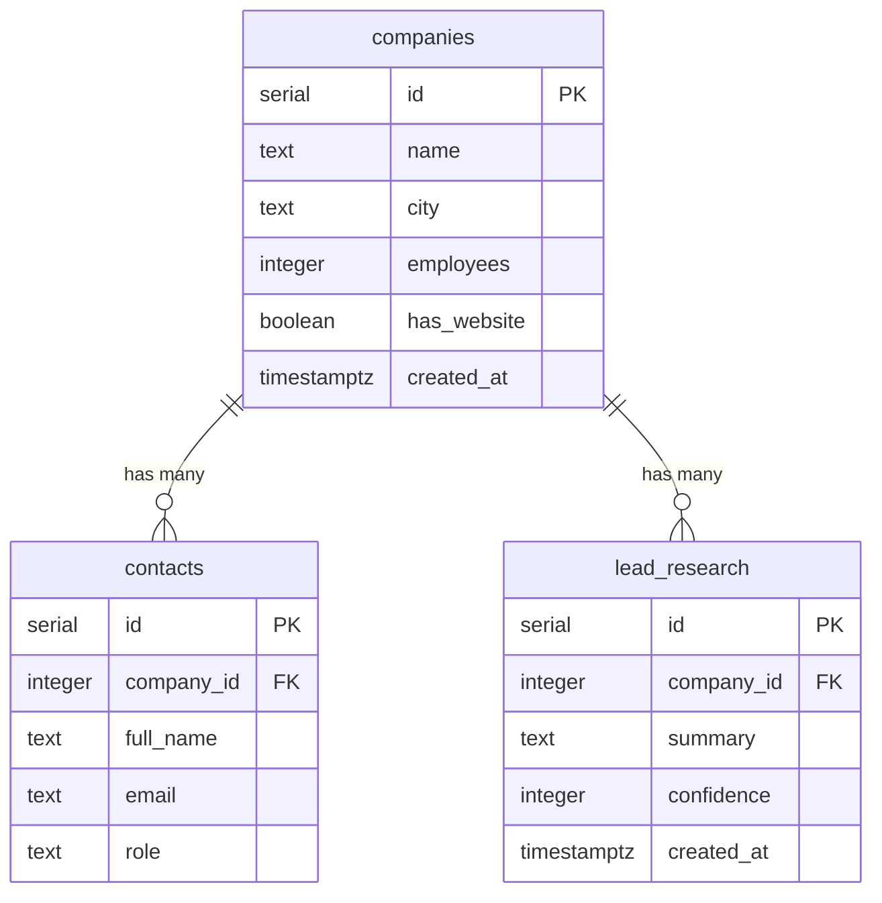

# OutreachOS Database Schema

## Entity-Relationship Diagram

## How to rebuild the database from scratch

1. Open the Supabase SQL Editor.
2. Copy the entire contents of `week2/sql/schema.sql`.
3. Paste and run it.
4. This drops and recreates `companies`, `contacts`, and `lead_research`, so you start fresh.

**Warning:** `schema.sql` contains `DROP TABLE` statements. Only run it on your development database. Free Supabase projects can pause after 7 days of inactivity — if yours pauses, you may need to reactivate it in the dashboard before running SQL.

## Tables

| Table | Purpose |
|-------|---------|
| `companies` | One row per company (name, city, employees, website flag) |
| `contacts` | One row per person at a company, linked by `company_id` |
| `lead_research` | AI-generated summaries and confidence scores per company |

## Constraints

- `companies.id` is the primary key (unique, auto-generated).
- `contacts.company_id` is a foreign key to `companies.id` (every contact belongs to a real company).
- `contacts.email` is unique per `company_id` (no duplicate emails within one company).
- `lead_research.company_id` is a foreign key to `companies.id`.
- `NOT NULL` on key columns prevents missing required data.